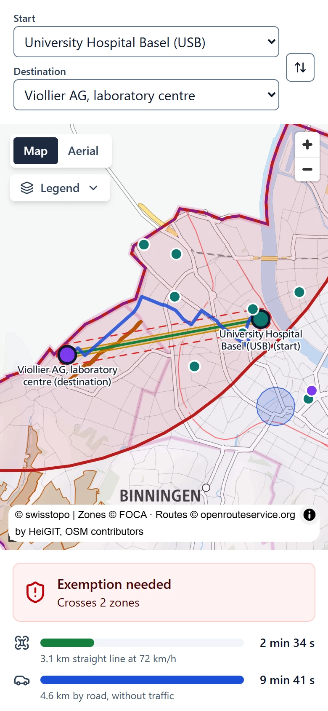

# Basilink

**Drone corridors for lab samples in Basel.** Basilink is a pre-check tool for logistics and
operations teams in hospitals and labs. For a start and a destination, it checks whether a direct
drone corridor crosses official drone restriction zones published by the Federal Office of Civil
Aviation (FOCA/BAZL). It also compares the estimated flight time with the driving time.

> **Pre-check only.** Basilink does not replace an authorisation from FOCA or any other competent
> authority. Temporary restrictions (DABS/NOTAM) are not included.

**Live:** [basilink.vercel.app](https://basilink.vercel.app)


Status: the MVP and the stretch goals are complete and deployed: the 3D view (D27), the matrix
of all pairs (D28) and driving times with typical traffic (D29). Zones in Germany and France were
dropped in favour of showing the part of a corridor abroad (D26).

## Why Basel?

Drones have carried lab samples between Swiss hospitals since 2017:

- in Lugano and Zurich, operated by Matternet (together with Swiss Post until 2022)
  ([Swiss Post](https://www.swisspost.ch/en/about-us/media/press-releases/2022/swiss-post-hands-over-its-drone-operation-to-matternet),
  [Matternet](https://investor.matternet.com/news-events/press-releases/detail/98/matternet-launches-worlds-longest-urban-drone-delivery-route-connecting-hospitals-and-laboratories-in-zurich-switzerland));
- since 2023 between Buchs SG and Vaduz, for a lab group
  ([SRF](https://www.srf.ch/news/schweiz/transportdrohne-fuer-labors-diese-drohne-fliegt-20-mal-taeglich-mit-laborproben)).

No such service is publicly known in Basel (November 2026), and Basel is a hard case:

- The EuroAirport and the Basel control zone cover most of the city. The airport zone is managed by
  the French civil aviation authority (DGAC).
- France and Germany are only a few kilometres from every hospital.

Basilink makes this visible before anyone writes an application. With the default assumptions
and the zones as of November 2026, 115 of the 136 site pairs need an exemption, and 11 corridors
leave Switzerland.

## How the check works

1. Pick a start and a destination: in the selects, in the site list, or by clicking two sites on
   the map.
2. Around the direct line, Basilink builds the **operational volume** that a drone could occupy.
   Its size follows the SORA 2.5 method used by FOCA. With the defaults it extends ±49.6 m around
   the line and up to 115.4 m above ground.
3. Basilink measures the distance from the flight line to every FOCA restriction zone. A zone
   closer than the half width of the volume lies in the corridor; then its lower and upper limit
   decide. The calculation runs in the Swiss grid LV95 (metres).
4. The result lists every zone as one of:
   - **conflict**
   - **passes below**
   - **ground risk buffer only**

   It also names the authorities to contact. If the corridor leaves Switzerland, the map darkens
   the part abroad and the warning names the authorities there.

5. The flight time (direct line at cruise speed) is compared with a pre-computed driving route
   without traffic. **Car by time of day** adds the driving time with typical traffic at 07:30,
   12:00, 17:30 and 22:00, asked live from Mapbox.
6. Switch the map to **3D** to see the corridor and the zones around it from the side, with
   heights drawn three times taller.
7. **All pairs** rates all 136 site pairs at once as a traffic-light matrix: red needs an
   exemption, amber leaves Switzerland, green has no zone conflict. A click opens the pair.

All assumptions can be changed in the panel. Their sources are documented in
[docs/decisions.md](docs/decisions.md) (D17, D18).

## Accessibility and mobile use



The target is WCAG 2.1 level AA.

- **The map is optional.** Every result is also text: verdict, times, zones and authorities.
  Sites can be chosen in two native selects or in the site list, not only by clicking the map.
- **Keyboard and screen readers:** native controls with visible focus, headings and labelled
  regions. A short summary is announced whenever the result changes. Invalid assumptions get a
  text error, not only a red border.
- **Phones:** the map follows directly after the pair selection. On narrow screens one finger
  scrolls the page and two fingers move the map, so the map does not trap the scroll. Nothing
  scrolls sideways down to a width of 320 px. Map animations respect "reduce motion".

How it was checked: [axe-core](https://github.com/dequelabs/axe-core) 4.14 (rules for WCAG 2.1 A
and AA plus best practices) in headless Chrome, in four states: empty, with a result, with an
invalid assumption, and at phone width. It reports no violations. Tab order and focus were walked
through by script. Not done yet: a test with real screen readers (NVDA, VoiceOver).

<br clear="right">

## Tests

`npm test` runs the unit tests with Vitest:

- the analysis: LV95 conversion, SORA volumes, corridor geometry, vertical limits, verdicts;
- formatting, flight parameters and the data scripts (zone transform, route parsing);
- the generated data: every ordered site pair has a route, zones match their metadata;
- the traffic function: listed sites only, the departure day, and Mapbox errors that never
  reveal the token;
- the app state end to end, with the real data files and no network, for example
  USB → Viollier needs an exemption because of the airport zone.

CI runs lint, format check, type check, tests and build on every push to `main` and every pull
request. The data update workflows run the tests before they commit new data.

## Getting started

Requires Node.js 22.18+ or 24.12+.

```sh
npm install
npm run dev          # start the app on http://localhost:5173
```

| Command                | What it does                                                                                          |
| ---------------------- | ----------------------------------------------------------------------------------------------------- |
| `npm run build`        | Type check and production build into `dist/`                                                          |
| `npm test`             | Unit tests (Vitest)                                                                                   |
| `npm run lint`         | ESLint                                                                                                |
| `npm run format:check` | Prettier                                                                                              |
| `npm run typecheck`    | vue-tsc                                                                                               |
| `npm run data:zones`   | Download the latest FOCA zones and rewrite `public/data/`                                             |
| `npm run data:routes`  | Compute driving routes for all site pairs (needs `ORS_API_KEY`; add `-- --missing` to fill gaps only) |
| `npm run data:border`  | Download the Swiss border around Basel (rarely needed)                                                |

## How the zone data gets into the app

`scripts/fetch-zones.ts` downloads the FOCA UAS zones in ED-269 format from
[data.geo.admin.ch](https://data.geo.admin.ch/browser/index.html#/collections/ch.bazl.einschraenkungen-drohnen).
It keeps the zones around Basel, simplifies them and writes a static GeoJSON file plus a metadata
file with the "data as of" date. A GitHub Action runs it every day and commits only when FOCA
published new data.

## Deployment

The app is a static site on [Vercel](https://vercel.com), connected to this repository, plus one
Vercel Function. Every push to `main` updates the production site, and every other branch gets
its own preview URL. Vercel detects the Vite setup and the `api/` folder on its own, so there is
no `vercel.json`.

The function `api/drive-times.ts` asks Mapbox for the driving times with typical traffic. Mapbox
forbids storing these results, so they cannot be pre-computed like the routes (D29). It needs
one environment variable in the Vercel project (Settings → Environment Variables, type Secret,
for Production and Preview): `MAPBOX_TOKEN`, a Mapbox access token without URL restrictions.
Without it, the rest of the app works and "Car by time of day" says the times are not available.
For `npm run dev`, put `MAPBOX_TOKEN=…` in `.env.local`; the dev server then serves the function.

Driving routes are pre-computed with OpenRouteService, so no API key ever reaches the browser. Two
GitHub Actions keep the data fresh and commit only when something changed:

| Workflow            | Runs    | Repository secrets                      |
| ------------------- | ------- | --------------------------------------- |
| `update-zones.yml`  | daily   | `VERCEL_DEPLOY_HOOK_URL`                |
| `update-routes.yml` | monthly | `ORS_API_KEY`, `VERCEL_DEPLOY_HOOK_URL` |

On the Vercel Hobby plan, only commits by the account owner deploy on their own. That is why the
workflows call a Vercel deploy hook after a data commit (Vercel project → Settings → Git → Deploy
Hooks, branch `main`). For local runs, put `ORS_API_KEY=…` in `.env.local`, which is git-ignored.

## Project structure

```
api/               Vercel Function: driving times with traffic (Mapbox)
scripts/           data preparation (runs in Node, no build step)
src/analysis/      the corridor check: LV95, SORA volumes, geometry, heights (unit-tested)
src/components/    Vue components
src/composables/   app state (useCorridorCheck)
src/config/        region, base maps, flight defaults, zone categories
src/data/          curated sites, route file names, data loading
src/map/           MapLibre overlay layers
src/server/        the function's logic, unit-tested (runs on Vercel, never in the browser)
src/types/         shared data types (also used by scripts/)
public/data/       generated data: zones, border, routes (do not edit by hand)
docs/              spike report, decision log, screenshots
```

## Documentation

- [DATA_SOURCES.md](DATA_SOURCES.md): every data source, its terms, processing and refresh
- [docs/decisions.md](docs/decisions.md): decisions and their reasons
- [docs/phase-0-spike.md](docs/phase-0-spike.md): verified data sources, limits and risks

## Troubleshooting

**Windows: every test fails with "Cannot read properties of undefined (reading 'config')".**
Your terminal reports the project path with a lower-case drive letter (`d:\…`). Vitest then loads
itself twice. Open the terminal in `D:\…` (upper case) and run the tests again. See
[vitest#5251](https://github.com/vitest-dev/vitest/issues/5251). CI is not affected.

## Data sources and licenses

Drone restriction zones: © FOCA (Opendata BY). Base map, imagery, border and terrain: © swisstopo.
Routes: © openrouteservice.org by HeiGIT, map data © OpenStreetMap contributors. Details are in
[DATA_SOURCES.md](DATA_SOURCES.md).
